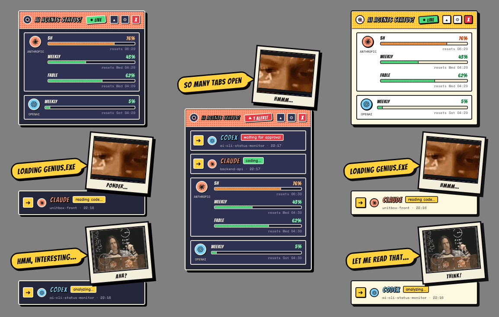
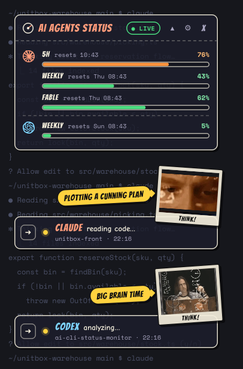
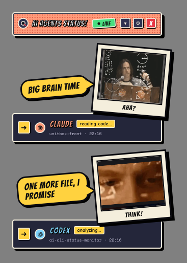
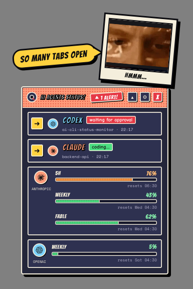
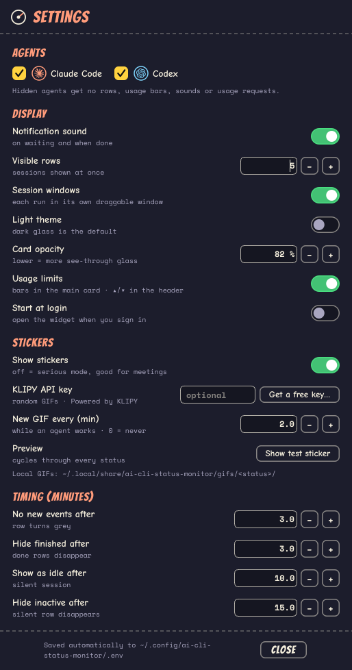
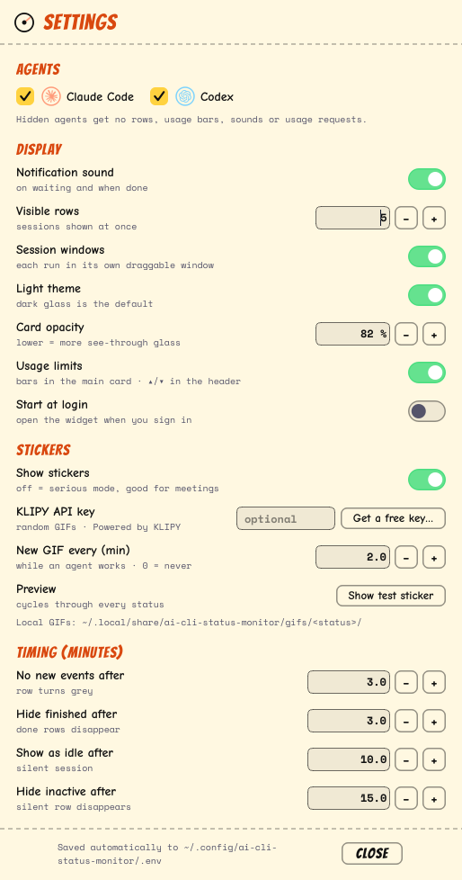
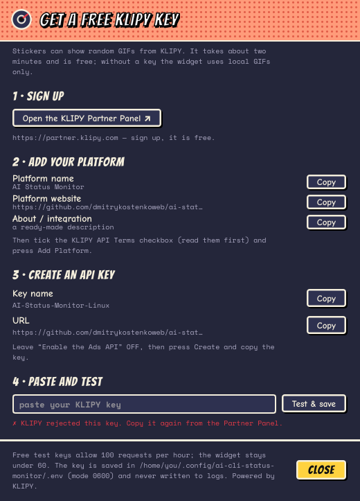

# AI Status Monitor


**A tiny comic-book widget that tells you what Claude Code and Codex are doing — and pings you when they need you.**

Run several AI agents in different terminals, switch to your browser, and stop wondering whether one of them is quietly waiting for your approval. AI Status Monitor floats on top of your desktop, shows one card per agent session, plays a sound when an agent waits for you or finishes, and jumps straight to the right terminal with one click.

Works on **Linux, macOS and Windows**. Python 3 + Qt — no Electron, no web server, no background daemon.

<p align="center">
  
</p>

---

## Contents

- [Features](#features)
- [Installation](#installation)
  - [Linux](#linux)
  - [macOS](#macos)
  - [Windows](#windows)
  - [Windows + WSL](#windows--wsl)
  - [After installing](#after-installing)
- [Using the widget](#using-the-widget)
- [Settings](#settings)
- [GIF stickers and a free KLIPY key](#gif-stickers-and-a-free-klipy-key)
- [Usage limits](#usage-limits)
- [Updates](#updates)
- [Configuration reference (`.env`)](#configuration-reference-env)
- [Command-line tools](#command-line-tools)
- [Troubleshooting](#troubleshooting)
- [Uninstalling](#uninstalling)
- [How it works](#how-it-works)
- [Limitations](#limitations)

---

## Features

- 🟢 **Live status per session**: `thinking`, `reading code`, `coding`, `running command`, `waiting for approval`, `done`, `error`. Each Claude Code / Codex run gets its own card.
- 🔔 **Notifications that matter**: a sound and a pulsing red outline when an agent waits for you, and a sound when it finishes.
- ➜ **Jump to the terminal**: the yellow arrow on a card raises the terminal window where that agent runs.
- 📊 **Usage limits at a glance**: Claude `5h` / `Weekly` / `Fable` and Codex `Weekly` bars. They turn orange at 75 % and red at 90 %, and fold away with one click.
- 🎞️ **Reaction GIF stickers** (optional, for fun): polaroids with speech bubbles from a local pool or from KLIPY with a free key. Turn **Show stickers** off (serious mode) for meetings.
- 🌗 **Dark and light comic themes**, always on top, visible on every workspace, never in the taskbar.
- 🔄 **Self-updating** from GitHub, with an `UPDATE ↑` button in the header.
- 🪶 **Lightweight and local**: the hooks write small JSON files, and the widget reads them once per second. No account, no telemetry.

| Session windows (default) | Usage limits folded away | Classic list |
|:---:|:---:|:---:|
|  |  |  |

---

## Installation

You need **Python 3.9+** and at least one of [Claude Code](https://docs.anthropic.com/en/docs/claude-code) or the [Codex CLI](https://github.com/openai/codex). The installer does all of this for you:

- copies the scripts;
- wires up the hooks for both CLIs, backing up your config first;
- installs the Qt UI library (PySide6) into a private folder;
- adds the widget to autostart;
- starts the widget.

It never uses `sudo` and is safe to re-run.

### Linux

**1. Install the system packages** (Debian / Ubuntu / Mint; use your distro's equivalents elsewhere):

```bash
sudo apt install python3-venv libxcb-cursor0 wmctrl
```

| Package | Why |
|---|---|
| `python3-venv` | lets the installer create a private Python environment for Qt |
| `libxcb-cursor0` | required by Qt 6.5+ on X11 / XWayland |
| `wmctrl` | the `➜` jump-to-terminal button (and a fallback for always-on-top) |

**2. Run the installer:**

```bash
curl -fsSL https://raw.githubusercontent.com/dmitrykostenkoweb/ai-status-monitor/main/install.sh | bash
```

The widget appears right away, and you can drag it anywhere by its header. It also gets a launcher called **AI CLI Status Widget** in your applications menu.

### macOS

Open **Terminal** and run:

```bash
curl -fsSL https://raw.githubusercontent.com/dmitrykostenkoweb/ai-status-monitor/main/install.sh | bash
```

That is all. macOS uses the same folders as Linux (`~/.local/bin`, `~/.cache`, `~/.config`, `~/.local/share`).

The first time you press `➜`, macOS may ask to allow **Accessibility** access for your terminal or Python. The window switch needs it.

### Windows

1. Install [Python 3.9+](https://www.python.org/downloads/). Tick **"Add python.exe to PATH"** in the installer.
2. Install [Git](https://git-scm.com/download/win). The one-line installer uses it to download the project.
3. Open **PowerShell** and run:

```powershell
irm https://raw.githubusercontent.com/dmitrykostenkoweb/ai-status-monitor/main/install.ps1 | iex
```

The widget starts without a console window (`pythonw.exe`). The installer also makes it a regular Windows app:

- an **AI Status Monitor** shortcut in the **Start menu** and on the **desktop** opens the widget again after you close it. Right-click it → **Pin to taskbar** for a taskbar button;
- **Settings → Apps → Installed apps** lists **AI Status Monitor**, and its **Uninstall** button removes it.

The widget's own windows stay out of the taskbar on purpose. The tools go to `%LOCALAPPDATA%\ai-cli-status-monitor\bin`, each with a `.cmd` wrapper such as `ai-agent-status-doctor.cmd`.

### Windows + WSL

Claude Code or Codex running **inside WSL** cannot see the hooks installed on Windows, so the Windows widget gets no events from them and shows no cards. Install the hooks inside WSL too; they write straight into the Windows widget's folder:

1. Install the widget on Windows first (above).
2. In your WSL shell, run the Linux installer:

   ```bash
   curl -fsSL https://raw.githubusercontent.com/dmitrykostenkoweb/ai-status-monitor/main/install.sh | bash
   ```

   Inside WSL, when it finds the Windows widget, the installer does a **hooks-only** install: no Qt, no autostart, no Linux widget. It sets `AI_STATUS_CACHE_DIR` in WSL's `~/.config/ai-cli-status-monitor/.env` to the Windows cache dir (`/mnt/c/Users/<you>/AppData/Local/ai-cli-status-monitor/cache`) and merges the hooks into WSL's `~/.claude/settings.json` / `~/.codex/hooks.json` (backing them up first). `ai-agent-status-update` keeps it that way.
3. Restart the Claude Code / Codex sessions in WSL so they load the hooks.

Statuses, sounds and GIF stickers work as for Windows sessions. The `➜` button cannot use Linux process IDs, so for WSL sessions it can only find the terminal by its window title (the project name).

Options: `--windows-widget` forces this mode (e.g. on a WSL install that already has the Linux widget), `--no-windows-widget` installs the Linux widget instead (for WSLg), and `--hooks-only` skips the widget anywhere. With `curl … | bash -s -- --windows-widget` or `./install.sh --windows-widget`. Both the WSL hooks and the Windows widget need version 0.5.1 or newer.

### After installing

1. **Restart your Claude Code / Codex sessions** so they pick up the new hooks.
2. **Codex only:** type `/hooks` inside Codex and approve (trust) the new hooks.
3. **Check that everything is green:**

   ```bash
   ~/.local/bin/ai-agent-status-doctor
   ```

   On Windows, run `%LOCALAPPDATA%\ai-cli-status-monitor\bin\ai-agent-status-doctor.cmd`.

4. Send any prompt to Claude or Codex. A card should appear within a second.

Just want to see it first? `~/.local/bin/ai-agent-status-widget --demo` shows rotating fake statuses, and no hooks are needed.

<details>
<summary><b>Install from a git clone</b> (to edit <code>.env</code> before installing, or to hack on it)</summary>

```bash
git clone https://github.com/dmitrykostenkoweb/ai-status-monitor.git
cd ai-status-monitor
cp .env.default .env      # optional: edit your local .env
./install.sh              # Linux / macOS
python install.py         # any OS
# Windows from a clone: powershell -ExecutionPolicy Bypass -File install.ps1
```

The real installer is `install.py` (cross-platform). `install.sh` and `install.ps1` only add the one-line bootstrap, which clones into `~/.local/share/ai-cli-status-monitor/src`.

</details>

<details>
<summary><b>What the installer changes</b></summary>

**Hooks.** They are merged into your existing config. The file is backed up first as `*.bak.<timestamp>`, and hooks that are already present are skipped.

- **Claude Code:** `~/.claude/settings.json`. Events: `UserPromptSubmit`, `PreToolUse`, `PostToolUse`, `Notification`, `Stop`, `StopFailure`.
- **Codex CLI:** `~/.codex/hooks.json`. Events: `UserPromptSubmit`, `PreToolUse`, `PermissionRequest`, `PostToolUse`, `SubagentStop`, `Stop`.
- **Manual examples:** [`examples/claude-settings-snippet.json`](examples/claude-settings-snippet.json) and [`examples/codex-hooks.json`](examples/codex-hooks.json).
- **Hook command:** `~/.local/bin/ai-agent-status-hook --agent claude|codex` on Linux/macOS, and `"<python.exe>" "<bin>/ai-agent-status-hook" --agent claude|codex` on Windows.

**Qt (PySide6).** If the installing Python cannot import PySide6, the installer creates `<data dir>/venv` and installs `PySide6-Essentials` there. This is a one-time download of about 100 MB.

- `AI_STATUS_WIDGET_PYTHON=/path/to/python` uses your own interpreter instead.
- `AI_STATUS_SKIP_PIP=1` skips the download. Hooks and status files still work without Qt.

**Autostart.**

- Linux: `~/.config/autostart/ai-cli-status-widget.desktop`
- macOS: `~/Library/LaunchAgents/com.github.ai-cli-status-monitor.widget.plist`
- Windows: `HKCU\Software\Microsoft\Windows\CurrentVersion\Run\ai-cli-status-monitor`

If you turned **Start at login** off in Settings, re-installing keeps it off.

**Files.** Paths are for Linux/macOS. On Windows, cache, data and bin live under `%LOCALAPPDATA%\ai-cli-status-monitor`, and config lives under `%APPDATA%\ai-cli-status-monitor`.

| Path | What |
|---|---|
| `~/.local/bin/ai-agent-status-*` | the hook, the widget and the helper tools |
| `~/.config/ai-cli-status-monitor/.env` | your settings (mode `0600`, never overwritten on reinstall) |
| `~/.config/ai-cli-status-monitor/widget.json` | widget position (+ legacy settings) |
| `~/.config/ai-cli-status-monitor/session_windows.json` | positions of session cards you dragged away |
| `~/.cache/ai-cli-status-monitor/` | statuses, logs (`widget.log`), usage cache |
| `~/.local/share/ai-cli-status-monitor/` | Qt venv, fonts, sound, logos, local GIFs, version, source clone |
| `~/.local/share/applications/ai-cli-status-widget.desktop` | Linux app-menu launcher (icon in `~/.local/share/pixmaps/`) |

</details>

---

## Using the widget

### The main card


- **Header**:
  - the title `AI Agents Status` and a state badge: `● LIVE` while agents work, `▲ N ALERT` when someone waits for you, `● IDLE` when all is quiet;
  - `▴` / `▾` folds the usage limits away (the agent cards and their GIFs stay);
  - `⚙` opens Settings;
  - `X` quits.
- **Usage limits**: one row per provider. Click the Anthropic or OpenAI mark to refresh it now.
- **Session cards**: every running session gets its own see-through card, docked in a column under the widget. Each card shows:
  - a `➜` that jumps to the terminal;
  - a status dot and the agent's status: yellow while thinking or reading, green while coding, red while waiting or on an error, blue when done;
  - the project folder and the time of the last event.
- **Glass**: the cards are translucent so the terminal behind them stays visible. Settings → **Card opacity** makes them more or less see-through.
- **Move things around**: drag the widget by its header. Drag a session card away and it stays where you drop it. Right-click it → `Dock under the widget` brings it back.
- **Right-click menu**: `Settings…`, `Show agents`, `Serious mode (no stickers)`, `Dock all session windows`, `Reload`, `Open logs folder`, `Check for updates`, `Quit`.

Prefer everything in one box? Turn **Session windows** off in Settings for the **classic list**. It shows up to 5 rows inside the main card, with a `+N finished, hidden automatically` footer, and the AI Status Monitor logo while nothing runs.

<br clear="right" />

### What happens over time

| When | What you see |
|---|---|
| an event arrives | the card updates within a second |
| the agent needs you (approval, a question) | red dot, pulsing red outline, `ALERT` badge, notification sound |
| the agent finishes | `done` + sound; the card disappears after 3 minutes |
| no events for 3 min | the row dims and shows `no new events` |
| no events for 10 min | `idle` |
| no events for 15 min | the row is hidden |

All four times can be changed in **Settings → Timing**.

---

## Settings

Open Settings with **`⚙`** in the header, or right-click → **`Settings…`**. Every change applies instantly and is saved to your `.env`.

| Dark | Light |
|:---:|:---:|
|  |  |

- **Agents**: show Claude Code, Codex, or both. Hidden agents get no rows, sounds or usage requests.
- **Display**:
  - notification sound;
  - visible rows;
  - session windows on/off;
  - **light theme**;
  - **card opacity** (40–95 %);
  - **usage limits** on/off;
  - **Start at login**: turn it off and the widget no longer starts with your computer.
- **Stickers**:
  - **Show stickers** (off = serious mode, no GIFs at all);
  - the **KLIPY API key** with a **Get a free key…** guide;
  - how often a working session gets a new GIF;
  - **Show test sticker**.
- **Timing**: when rows turn grey, when finished rows disappear, and when silent sessions go idle or get hidden.

---

## GIF stickers and a free KLIPY key

While an agent works, its card wears a tilted polaroid with a reaction GIF and a speech bubble. The sticker changes when the status changes:

| Sticker | Shown for |
|---|---|
| `analyzing` | thinking, reading, analyzing |
| `coding` | editing files, running commands |
| `waiting` | waiting for approval / your answer (stays until you react) |
| `done` | finished |
| `error` | API or tool error (stays until the status changes) |
| `limit` | a usage bar reaches 90 % (once per limit window) |
| `idle` | a silent session turns idle |

Out of the box the widget uses a small local GIF pool. For a fresh random GIF every time, add a **free KLIPY key**.

### Get a free KLIPY key (about 2 minutes)

The widget has a built-in step-by-step guide with **Copy** buttons for every value. Open it from **⚙ Settings → Stickers → `Get a free key…`**. While no key is set, it is also in the right-click menu → `Get GIFs from KLIPY (free key)…`.

<p align="center">
  
</p>

1. **Sign up.** Click **Open the KLIPY Partner Panel** (<https://partner.klipy.com>) and create a free account.
2. **Add your platform.** In the Partner Panel, add a new platform with:

   | Field | Value |
   |---|---|
   | Platform name | `AI Status Monitor` |
   | Platform website | `https://github.com/dmitrykostenkoweb/ai-status-monitor` |
   | Description | `Desktop AI agent status widget with KLIPY GIFs` (max 50 characters) |

   Read the **KLIPY API Terms**, tick the checkbox, and press **Add Platform**.
3. **Create an API key.**

   | Field | Value |
   |---|---|
   | Key name | `AI-Status-Monitor-Windows` / `-macOS` / `-Linux` for your OS (any name works) |
   | URL | `https://github.com/dmitrykostenkoweb/ai-status-monitor` |
   | Enable the Ads API | **leave it OFF** |

   Press **Create** and copy the key.
4. **Paste and test.** Paste the key into the guide's last field and press **`Test & save`**. The widget runs one test search and tells you one of four things:
   - ✓ the key works;
   - ✗ KLIPY rejected it;
   - the key hit its hourly limit;
   - KLIPY could not be reached.

   Only a working key is saved.

You can also put the key in your `.env` by hand: `AI_STATUS_KLIPY_API_KEY=your-key`.

> **Privacy and limits.** The key is stored only in your runtime `.env` (mode `0600`) and is never written to logs. Free test keys allow 100 requests per hour. The widget makes at most 60 new searches per hour and reuses results it already has after that. Following KLIPY's [integration requirements](https://docs.klipy.com/integration-requirements), GIFs are loaded straight from KLIPY into memory and are **never saved to disk**. Stickers showing a KLIPY GIF carry a small `KLIPY` mark.

<details>
<summary><b>More about stickers</b>: your own GIFs, variety, custom texts, Polish set</summary>

**Where GIFs come from**, in order:

1. **KLIPY**, when a key is set. Each status change triggers a search for a fitting phrase (`thinking`, `typing fast`, `victory dance`, …) and shows one random result. Only the result list (URLs) is reused for an hour. Offline, or on any error, the widget silently falls back to the local pool.
2. **Your local pool.** Any `.gif`, `.webp`, `.png` or `.jpg` in `~/.local/share/ai-cli-status-monitor/gifs/<sticker>/`, e.g. `gifs/waiting/skeleton.gif`. The installer seeds `gifs/analyzing/` and never overwrites your files.
3. **A striped placeholder** in the status colour.

**Variety.** The widget never repeats any of the last 200 GIFs. Phrases and bubble lines are dealt like a shuffled deck. Each KLIPY search asks for 50 results on a random page 1–3. A working session gets a new GIF every 2 minutes (**Settings → Stickers → New GIF every**, `0` = never). Right-click a session card → `Show another GIF` swaps it immediately.

**Classic list.** One sticker pops out of the main card on each status change and tucks away after 4 seconds. `waiting` and `error` stay until the status changes. Hovering a row shows its last sticker again. Stickers need a compositing desktop; Cinnamon, GNOME, KDE, macOS and Windows have one by default.

**Custom texts.** Override bubble lines and KLIPY search phrases per sticker in `~/.config/ai-cli-status-monitor/stickers.json`. A ready-made **Polish** set is in [`examples/stickers.pl.json`](examples/stickers.pl.json): copy it there and restart the widget.

```json
{
  "bubbles": {"waiting": ["Dima? Halo?", "halo? jest tam kto?"], "done": ["gotowe!"]},
  "queries": {"coding": ["hacker typing", "cat keyboard"]}
}
```

**Preview.** **Settings → Show test sticker**, or `~/.local/bin/ai-agent-status-widget --sticker all` (or `--sticker waiting`, …).

**Serious mode** (Settings → `Show stickers` off, the right-click menu, or `AI_STATUS_SERIOUS_MODE=true`) turns stickers off completely, and with them all KLIPY requests.

</details>

---

## Usage limits

The main card shows how much of your plan you have used. It refreshes every two minutes; click a provider's disc to refresh just that one.

| Provider | Bars | Source |
|---|---|---|
| Claude Code | `5h`, `Weekly`, and `Fable` (only if your account has a separate Fable allowance) | Claude Code's authenticated usage endpoint |
| Codex | `Weekly` | the installed Codex CLI (app-server); recent local `rate_limits` events in `~/.codex/sessions/` as a fallback |

Bars are **green** below 75 %, **orange** from 75 % and **red** from 90 %. Don't need them? Press `▴` in the header or turn off **Settings → Usage limits**. Hidden limits are not fetched at all.

- **Your credentials stay where they are.**
  - Claude: the widget reuses the OAuth token Claude Code already stores. It reads `~/.claude/.credentials.json`, or the `Claude Code-credentials` login Keychain item on macOS. The token is used only in memory for the request and is never copied to cache or logs.
  - Codex: authentication stays inside the Codex CLI.
- **Cache:** only normalized, non-secret numbers go to `~/.cache/ai-cli-status-monitor/usage_limits.json`.
- **Failures:** each provider fails independently. A last-known value shows as `stale` until its reset time, then as `Unavailable`.
- **Not supported:** API-key billing quotas.

---

## Updates

A few seconds after it starts, the widget asks GitHub once for the latest version. If a newer one exists, a yellow **`UPDATE ↑`** button appears in the header and the right-click menu gets **`Update to …`**. Click either to update and restart. Offline, the check silently does nothing.

From the terminal:

```bash
~/.local/bin/ai-agent-status-update            # update now (pull, reinstall, restart)
~/.local/bin/ai-agent-status-update --check    # only check
~/.local/bin/ai-agent-status-widget --version  # installed version
```

The updater pulls the source clone recorded at install time (`~/.local/share/ai-cli-status-monitor/install_source`). If that clone is missing, it clones into `~/.local/share/ai-cli-status-monitor/src`. Then it re-runs the installer. Forks and mirrors can set `AI_STATUS_UPDATE_REPO` (`owner/repo`) and `AI_STATUS_UPDATE_BRANCH`.

---

## Configuration reference (`.env`)

Most options are in **Settings**. Everything else lives in `~/.config/ai-cli-status-monitor/.env`; on Windows it is `%APPDATA%\ai-cli-status-monitor\.env`. The file is created on the first install with mode `0600`, and later installs never overwrite it. Public defaults are in [`.env.default`](.env.default).

| Variable | Default | Meaning |
|---|---|---|
| `AI_STATUS_AGENTS` | `claude,codex` | which agents to show: `claude,codex` (or `all`), `claude`, `codex` |
| `AI_STATUS_THEME` | `dark` | `dark` or `light` |
| `AI_STATUS_SURFACE_OPACITY` | `82` | opacity of the glass cards in percent, 40–95 |
| `AI_STATUS_SESSION_WINDOWS` | `true` | one card per session; `false` = classic list |
| `AI_STATUS_SHOW_LIMITS` | `true` | usage-limit bars; `false` hides them and skips usage requests |
| `AI_STATUS_AUTOSTART` | `true` | start at login; `false` removes the login entry (reinstalls keep it off) |
| `AI_STATUS_SOUND_ENABLED` | `true` | notification sound (`true`/`false`, `yes`/`no`, `on`/`off`, `1`/`0`) |
| `AI_STATUS_MAX_ROWS` | `5` | rows shown at once |
| `AI_STATUS_TITLE` | `AI Agents Status` | header title *(restart needed)* |
| `AI_STATUS_CARD_WIDTH` | `340` | card width in px *(restart needed)* |
| `AI_STATUS_STALE_AFTER_SECONDS` | `180` | row dims, shows `no new events` |
| `AI_STATUS_HIDE_DONE_AFTER_SECONDS` | `180` | finished rows disappear |
| `AI_STATUS_IDLE_AFTER_SECONDS` | `600` | silent session turns `idle` |
| `AI_STATUS_HIDE_STALE_AFTER_SECONDS` | `900` | silent row is hidden |
| `AI_STATUS_SERIOUS_MODE` | `false` | `true` = no GIF stickers, no KLIPY requests |
| `AI_STATUS_KLIPY_API_KEY` | *(empty)* | KLIPY key for random GIFs; empty = local GIFs only |
| `AI_STATUS_STICKER_ROTATE_SECONDS` | `120` | new GIF for a working session every N s (`0` = never) |
| `AI_STATUS_UPDATE_REPO` / `AI_STATUS_UPDATE_BRANCH` | `dmitrykostenkoweb/ai-status-monitor` / `main` | where updates come from |
| `AI_STATUS_CACHE_DIR`, `AI_STATUS_CONFIG_DIR`, `AI_STATUS_DATA_DIR` | see [installer files](#installation) | directories *(restart needed)* |
| `AI_STATUS_ENV_FILE` | — | use a different runtime file. It must be exported in the process; it is not read from `.env` |

**Precedence:** a variable exported in the process → runtime `.env` → legacy value in `widget.json` → built-in default. Re-installing upgrades values that still hold an old default (card width `344`/`420`, title `AI Agents Status`) to the new ones; values you changed are kept.

`.env` keeps secrets out of Git, but it does not encrypt them. If a key ever lands in a commit, revoke and rotate it.

---

## Command-line tools

All tools are in `~/.local/bin`. On Windows they are in `%LOCALAPPDATA%\ai-cli-status-monitor\bin`, as `.cmd` wrappers.

| Command | What it does |
|---|---|
| `ai-agent-status-widget` | run the widget (`--demo` for fake statuses, `--sticker <key\|all>` to preview stickers, `--version`) |
| `ai-agent-status-widget-start` / `-stop` | start or stop the background widget |
| `ai-agent-status-doctor` | health check (details below) |
| `ai-agent-status-update` | update from GitHub (`--check` to only check) |
| `ai-agent-status-panel` | print the current combined status (debugging) |
| `ai-agent-status-uninstall` | remove the app (`--yes` to skip the question, `--purge` to delete your settings too) |
| `ai-agent-status-hook --agent claude\|codex --test` | send synthetic events through the whole pipeline |

The doctor checks:

- the installed scripts and the cache folder;
- autostart;
- the Claude and Codex hooks;
- that the widget's Python can import PySide6;
- `wmctrl` and `libxcb-cursor0` (Linux);
- the hook test mode;
- the installed version and whether an update is available.

---

## Troubleshooting

**Start here:**

```bash
~/.local/bin/ai-agent-status-doctor
```

<details>
<summary><b>No cards appear when an agent works</b></summary>

- Restart the Claude Code / Codex session after installing, because hooks load at startup.
- **Codex:** type `/hooks` and approve or trust the new hooks.
- Test the pipeline without any CLI:

  ```bash
  ~/.local/bin/ai-agent-status-hook --agent claude --test
  ~/.local/bin/ai-agent-status-hook --agent codex --test
  ~/.local/bin/ai-agent-status-panel
  ```

- Look at the raw files:

  ```bash
  ls -la ~/.cache/ai-cli-status-monitor/statuses/
  ls -la ~/.cache/ai-cli-status-monitor/last_payloads/ ~/.cache/ai-cli-status-monitor/debug_payloads/
  ```

  Each console has its own file in `statuses/`. `claude.json` / `codex.json` hold the latest status of each agent, for older scripts.

</details>

<details>
<summary><b>The widget does not start on Linux</b></summary>

`Could not load the Qt platform plugin "xcb"` (in `~/.cache/ai-cli-status-monitor/widget.log` or in the doctor) means `libxcb-cursor0` is missing:

```bash
sudo apt install libxcb-cursor0
```

If the installer could not create the Qt environment, install `python3-venv` and re-run the installer.

</details>

<details>
<summary><b>The widget is not always on top (Linux)</b></summary>

Check that it runs on X11 (`(xcb)` in the log):

```bash
grep "widget started" ~/.cache/ai-cli-status-monitor/widget.log | tail -1
```

On Wayland the widget runs through XWayland when `libxcb-cursor0` is installed. Full-screen windows (videos, presentations) still cover it; that is how window managers work.

</details>

<details>
<summary><b>No sound</b></summary>

The sound plays only when an agent starts waiting for you or finishes. The widget uses the first player it finds:

- macOS: `afplay`;
- Windows: PowerShell (Windows Media Player engine);
- Linux: `mpv`, `ffplay`, `mpg123`, `gst-play-1.0` or `paplay`.

Check `~/.cache/ai-cli-status-monitor/widget.log`, and make sure **Settings → Notification sound** is on.

</details>

<details>
<summary><b>The ➜ button raises the wrong window (or none)</b></summary>

- **Linux:** needs `wmctrl`. When one terminal process owns several windows (gnome-terminal), the window title (project folder) breaks the tie. One-process-per-window terminals such as alacritty, kitty and xterm always match exactly.
- **macOS:** allow Accessibility access for your terminal / Python in System Settings → Privacy & Security.
- **Windows:** targets the Windows Terminal or console window.
- **Everywhere:** no platform can switch to a specific tab. Under tmux, screen or ssh the match may miss. A diagnostic line is written to `widget.log`.

</details>

<details>
<summary><b>Usage bars say <code>Unavailable</code></b></summary>

- Claude needs an active Claude Code OAuth login. API-key billing is not supported.
- Codex needs the `codex` CLI on your `PATH`.

Both integrations are best-effort and may break for a while if a provider changes its private data format. Inspect `~/.cache/ai-cli-status-monitor/usage_limits.json`.

</details>

---

## Uninstalling

Run the uninstaller:

```bash
~/.local/bin/ai-agent-status-uninstall
```

On Windows, use **Settings → Apps → Installed apps → AI Status Monitor → Uninstall**, or run `%LOCALAPPDATA%\ai-cli-status-monitor\bin\ai-agent-status-uninstall.cmd`.

It shows what it will delete and asks first. Then it removes:

- the widget and its login entry;
- the menu, Start-menu and desktop shortcuts;
- its own hooks from `~/.claude/settings.json` and `~/.codex/hooks.json`. Your other hooks stay, and each file is backed up first as `*.bak.<timestamp>`;
- the scripts, and the data and cache folders.

Your settings folder (`~/.config/ai-cli-status-monitor`, on Windows `%APPDATA%\ai-cli-status-monitor`) is kept. Add `--purge` to delete it too. Restart your Claude Code / Codex sessions afterwards.

---

## How it works

```text
Claude Code / Codex ──hook──▶ ai-agent-status-hook ──writes──▶ ~/.cache/ai-cli-status-monitor/statuses/<session>.json
                                                                             │
                                          ai-agent-status-widget ◀──reads once per second
```

- **The hook.** The CLIs run `ai-agent-status-hook` on each event (prompt, tool use, permission request, stop, …). It turns the event into a status (`kind` + text) and writes one small JSON file per session. It never crashes the CLI, even on bad input.
- **The widget.** The Qt widget reads those files once per second, sorts sessions (waiting → working → done), and handles the timers, sounds and stickers.
- **Networking.** The only network calls are:
  - the one-off GitHub update check;
  - the usage-limit lookups;
  - KLIPY searches, only when you set a key.

---

## Limitations

- **Status comes from events.** It is not a live view of the model's thoughts.
  - `thinking` is inferred from prompts and tool events.
  - `waiting for you` depends on the notification, stop and permission events each CLI sends.
- **Usage limits are best-effort.** They need a Claude Code OAuth login; API-key spend and billing limits are out of scope.
- **"On every workspace" is enforced only on Linux/X11.** There the widget re-asserts it every second, because Cinnamon/Muffin and GNOME/Mutter drop "above" now and then. On macOS and Windows it stays on the desktop/Space where it was opened. Always-on-top works everywhere.
- **Wayland needs XWayland**, because Wayland does not let apps place their own windows (docked cards, stickers).
- **WSL sessions shown on the Windows widget** can be raised by `➜` only through a window-title match, because the widget cannot see Linux process IDs.
- **One row per session, even without a session id.** Claude provides a `session_id`. For Codex, the session is identified by its terminal: the shell's POSIX session leader on Linux/macOS, or the console window on Windows.
